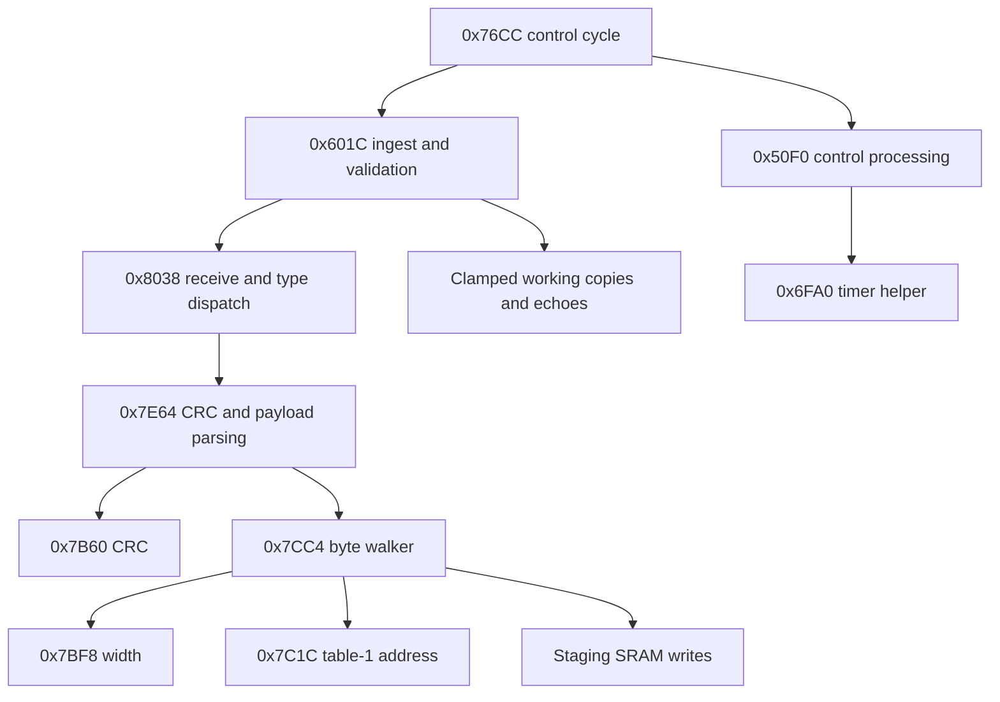

# Offline write-path review and work plan

October 22, 2026. Image: V2.8.4HF, SHA-256
`1ae519ba6194e8f7bdaaa94333a83a9e6fda3b0563f87f7d48383b37288c1780`.

## Goal and priorities

The offline goal is to establish how received values reach application state,
review the most consequential adjacent routines, test bounded models, and publish
reproducible findings with hardware limits. Priority order:

1. Receive frame → staging write → validation → control consumer.
2. Control-cycle ordering, outgoing frames, CRC and message-state checks.
3. Fixed-width bounds and incomplete-write behavior in a bounded offline model.
4. A complete ranked queue for remaining entries and discriminating bench tests.

This pass completes those bounded tasks. It does not finish every remaining
routine or every indirect call. The initial 14 reviewed roles grow to **21**;
**124** of the 145 catalog entries still await semantic review.

## Evidence and additional roles

Fresh IDA exports verify database bytes against the raw image. Binary Ninja checks
the same nine seeded Thumb entries; it is a decoder cross-check, not independent
entry discovery or ARMv4T instruction-set validation. Trace files:
[IDA](../audit/data/write_path_ida.json),
[Binary Ninja](../audit/data/write_path_binaryninja.json).

| Newly reviewed entry | Supported static role |
|---|---|
| `0x76CC` | Control-cycle orchestrator: capture unpack, ingest validation, control processing, conditional communications |
| `0x7B60` | MCU CRC-8/SAE-J1850 computation |
| `0x7CC4` | Payload-byte walker; resolves AIDs and writes table-1 staging SRAM |
| `0x7E64` | Frame CRC/residue check followed by payload walking |
| `0x7EB4` | Header/value/CRC frame construction using table-2 data reader |
| `0x7EFC` | Outgoing-data queue setup guarded by busy flags |
| `0x8038` | Receive-buffer and message-type dispatcher |

`0x7BF8` and `0x81A8` were also traced. The former confirms width selection;
the latter calls the frame builder and transmit helper in multiple branches, but
this pass does not assign a complete state-machine interpretation to it.

## Closed direct-call path



The arrows above are calls or supported data relationships, not a measured timing
diagram. Specific instruction anchors:

- `0x76D8` calls capture unpacker `0x59E8`; `0x76DC` calls `0x601C`;
  `0x76E0` calls `0x50F0`. Validation precedes control on this ordinary call path.
- `0x6024` calls `0x8038`; `0x6028` compares its result to 1 and `0x602A`
  skips the validation loop otherwise. This matters for incomplete payloads.
- `0x8038` branches by message type (0–5). Types 1/3 share a parser path;
  type 0 also parses; type 4 builds an AID-list response path. Types 2/5 have
  additional state-flag guards. This is more than an unconditional memory copier.
- `0x7E84` computes a CRC across the header-derived length; `0x7E88` checks
  residue `0x3B`. Only the success branch reaches `0x7EA2`, the walker call.
- `0x7D42` selects width, `0x7D4E` resolves table-1 SRAM, and `0x7D6C`
  stores a value byte. The walker does not call `0x601C` or apply its clamps.

These direct calls establish one normal ingest-to-control path. Interrupts,
alternate consumers and every indirect-call target are not exhausted here.

## Finding: the frame budget is bytes, not a universal AID count

At `0x7E9A`, the parser passes `(header & 15) - 1` as the payload-byte count.
At `0x7CD6`/`0x7CDC`, the walker caps that count at 14. Its loop increments once
per input byte. Read-list types 2/4 copy AID bytes; value-bearing types also consume
the values. Earlier descriptions of a universal "14 AIDs per frame" were too broad.

| Fixed value width | Bytes per AID/value pair | Complete pairs in 14 payload bytes |
|---|---|---|
| 1 | 2 | 7 |
| 2 | 3 | 4 |
| 3 | 4 | 3 |
| 4 | 5 | 2 |

Mixed widths consume the same shared byte budget. Variable-width AIDs need
separate length-prefix analysis; this table does not cover them.

The subsequent [compound-handler review](COMPOUND_AID_UPDATE_REVIEW.md) reproduces a concrete cross-AID continuation: an incomplete AID 146 walker result leaves a staged byte that a later successful AID 154 ingest applies through fall-through. It executes the original walker and handlers with scripted receive results; full framing/CRC and physical effects remain outside that sequence.

## Finding: staging writes precede the success/validation decision

`0x7CC4` writes each available value byte immediately. When the payload ends with
value bytes still missing, its final remaining-width test returns 2 rather than 1.
The stores have already happened, and no rollback occurs in the reviewed walker.
The ordinary `0x601C` call skips its validation loop unless `0x8038` returned 1.

For example, the fixed-width offline model of an AID 85 payload containing only
one of its two value bytes updates one byte of staging `0x200B30` while retaining
the prior second byte. It reports an incomplete result. **That is not evidence of
an unvalidated actuator command.** AID 85's normal working-copy update is in the
clamp dispatcher; this review does not prove a downstream consumer uses the
partially updated staging bytes. It identifies a concrete bench-test question.

The model (`tools/model_aid_ingest.py`) handles fixed-width payload walking only.
It excludes empty payloads, variable-width lookahead, radio/USB reception,
interrupt scheduling, and downstream state. It is not a CPU emulator. An empty
payload can reach the walker's final test without initializing R7 locally;
consequences depend on the actual calling state and are unresolved.

## Offline reproduction

```bash
python -m unittest discover -s tests -t . -v
python -m unittest tests.test_ingest_model -v
python audit/tools/build_review_queue.py
```

Both exporters now accept an explicit entry list. Reproduce the nine-entry check
using the same image and database-copy procedure as the earlier verification,
with `0x76cc,0x7b60,0x7bf8,0x7cc4,0x7e64,0x7eb4,0x7efc,0x8038,0x81a8`
as IDA's optional fourth script argument, or Binary Ninja's `--entries` value.

## Next offline queue

[The complete queue](../audit/data/offline_review_queue.json) contains every one
of the 124 unlabeled entries, ranked by undirected direct-call proximity to ingest,
control and timer anchors. Proximity is a review heuristic, not execution
reachability, a vulnerability score, or a semantic conclusion.

Highest-value next investigations: raw-staging readers outside the dispatcher;
the receive gate/buffer routines used by `0x8038`; full `0x81A8` state handling;
variable-width AIDs 220+; and interrupt/main-loop interactions. A complete proof
that all writes are validated requires those additional paths.

## Hardware acceptance checklist

| Question | Evidence needed |
|---|---|
| Does a complete fixed-width update pass through the inferred clamp? | Bench observation of staging, echo and working-copy values at boundaries |
| What happens to an incomplete payload? | Controlled bench observation of status and staging/working state; no engine attached |
| Are raw staging values consumed between receipt and validation? | Trace/debug observation including interrupt timing |
| Does the computed timer value produce the predicted pulse? | Measured timer clock and output waveform |
| Can altered firmware be accepted and recovered? | Bootloader capture/readout and a demonstrated recovery procedure |
| Does Bluetooth enforce authenticated pairing? | Module identification and measured pairing behavior |

No device traffic, firmware flashing, or engine experiment was performed.
